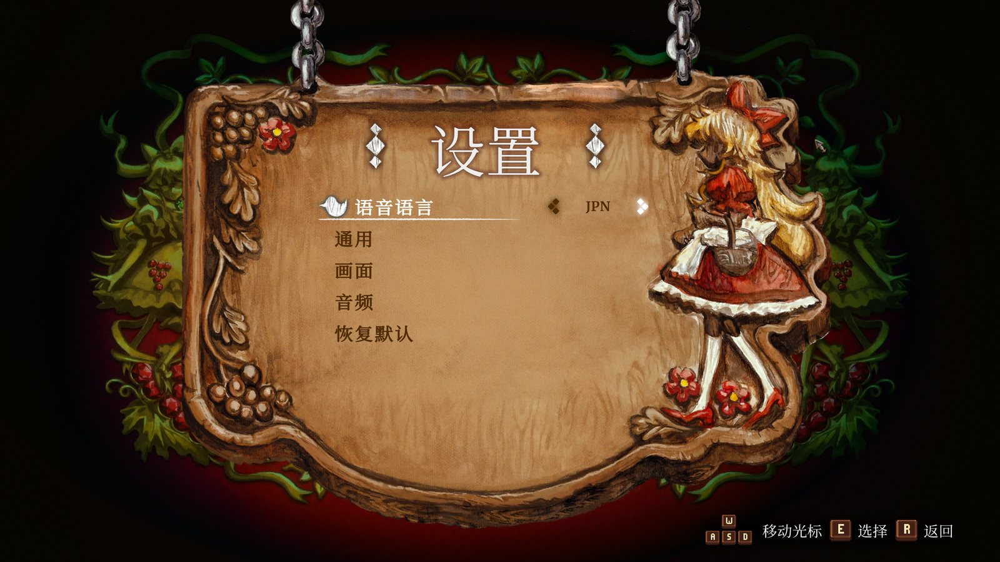
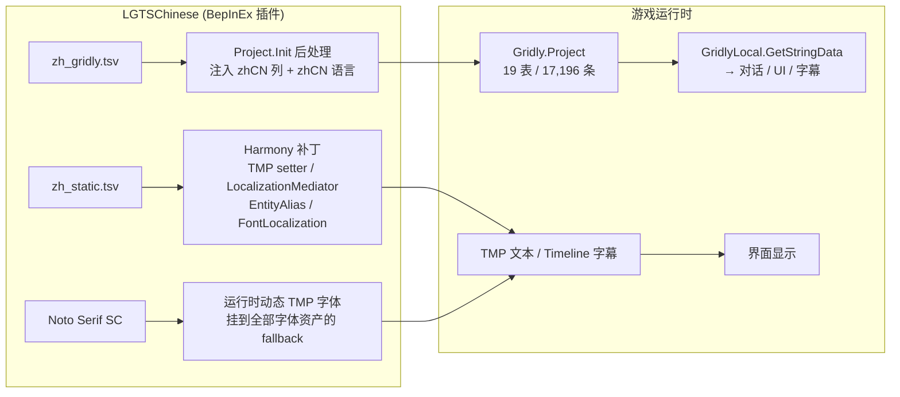

# LGTS-Chinese

《Little Goody Two Shoes》（Little Goody Two Shoes，Steam AppID 1812370）的**简体中文汉化补丁**，基于 BepInEx 运行时注入，不修改游戏资源文件。

> 当前状态：**v0.2.0 试玩版** —— 界面文本全部汉化 + 开场序章（第 1.5 章）+ 周日清晨（第 2.1 章）+ 开场 PV/绘本字幕。
> 第 2 章之后的剧情尚未翻译，进度与计划见 [TODO.md](TODO.md)。



## 特性

- **不改资源**：所有文本在运行时注入，补丁约 10 MB，可一键安装/卸载，随时切回英文；
- **贴合原生排版**：保留游戏原版英文字体，中文使用思源宋体（Noto Serif SC）作为动态回退字体，对话/UI 维持原版衬线风格；
- **翻译外置**：译文放在插件目录的两个 TSV 里（`zh_gridly.tsv` / `zh_static.tsv`），更新翻译不需要重新编译插件；
- **覆盖范围**：Gridly 文本 1,365 条（全部 UI 类 + 第 1.5 章 + 第 2.1 章 + PV 字幕）+ 硬编码 UI/字幕/代码文本 800 余条；
- **开源可构建**：插件源码 + 提取/翻译/打包工具链 + 翻译数据全部在本仓库。

## 安装

1. **关闭游戏**；
2. 解压补丁包，双击「安装.bat」，按提示确认游戏目录（默认 Steam 路径）；
3. 启动游戏即可，看到中文界面即成功。

详细说明见 [resources/安装说明.txt](resources/安装说明.txt)。

**卸载**：运行「卸载.bat」，或删除游戏目录下的 `winhttp.dll`、`doorstop_config.ini`、`.doorstop_version`、`BepInEx` 文件夹。

**切回英文**：编辑 `BepInEx/config/com.syukuu.lgts.zhcn.cfg`，把 `EnableChinese = true` 改为 `false`，重启游戏。

## 实现方案

游戏本身使用 **Gridly** 作为本地化系统：`resources.assets` 里的 `Gridly.Project` ScriptableObject 保存着 19 张表、17,196 条文本（英文原文），剧本 TextAsset 里只有 key。游戏字体全部是静态 SDF 图集，没有中文字形。

本补丁用 BepInEx + HarmonyX 在运行时做四件事：



关键在于：

1. **Gridly 文本注入**：在 `Gridly.Project.Init()` 之后，把 `zh_gridly.tsv` 里的译文作为 `zhCN` 列追加到每条 Record，并在 `langSupports` 中把 `zhCN` 放到第 0 位（默认语言）。之后游戏自己的查表逻辑都会返回中文。
2. **硬编码文本兜底**：`TMP_Text.text` setter、`LocalizationMediator`、角色别名、场景内 TMP 扫描等钩子，用 `zh_static.tsv` 的「英文原文 → 中文」字典翻译 Gridly 之外的文本（弹窗、训练提示、操作提示、Timeline 旁白等）。
3. **中文字体**：用 `new Font(字体文件路径)` 加载随包分发的思源宋体 → `TMP_FontAsset.CreateFontAsset(...Dynamic)` 运行时生成动态字体 → 挂到全部 TMP 字体资产的 `fallbackFontAssetTable`；对话/UI 通过 `FontLocalization.GetFont` 覆盖为中文衬线体。

更完整的实现细节、补丁点列表和设计取舍见 [docs/architecture.md](docs/architecture.md)；文本在游戏文件中的具体位置与逆向过程见 [docs/game-analysis.md](docs/game-analysis.md)。

## 仓库结构

```
LGTS-Chinese/
├─ src/LGTSChinese/          插件源码（C# / .NET Framework 4.7.2）
├─ data/
│  ├─ translations/          翻译数据（TSV + 术语表，见其 README）
│  └─ fonts/                 思源宋体（SIL OFL）+ 许可
├─ resources/                补丁包里的安装/卸载脚本、配置模板、安装说明
├─ scripts/
│  ├─ build.ps1              一键构建（编译插件 → 合并翻译 → 打包 zip）
│  └─ extract_all.ps1        从自己的游戏安装提取逆向数据到 work/
├─ tools/                    提取/解码/校验/打包脚本（Python）
├─ docs/                     架构、逆向分析、构建与翻译指南、截图
├─ TODO.md                   待办与已知问题
└─ requirements.txt
```

`work/`、`build/`、`dist/`、`vendor/` 都是本地生成目录，已在 `.gitignore` 中忽略（不提交游戏原始资源）。

## 从源码构建

环境要求：Windows、.NET SDK 8+、Python 3.9+、已安装游戏、已安装 BepInEx 5.4.x。

```powershell
# 1) 准备 BepInEx（仅首次）
#    下载 BepInEx_win_x64_5.4.23.6.zip 解压到 vendor/bepinex/
#    或者直接使用游戏目录里已安装的 BepInEx：设置 LGTS_BEPINEX_DIR

# 2) 编译 + 合并翻译 + 打包
pwsh -File scripts\build.ps1

# 产出：dist\LGTS_Chinese_v0.2.0.zip
```

只编译插件：

```powershell
$env:LGTS_GAME_DIR = "C:\Program Files (x86)\Steam\steamapps\common\Little Goody Two Shoes"
dotnet build src\LGTSChinese\LGTSChinese.csproj -c Release
```

## 参与翻译

剩余待翻译文本（第 2~8 章）见 [TODO.md](TODO.md)。翻译文件是纯 TSV，格式说明与贡献流程见 [data/translations/README.md](data/translations/README.md)。

```powershell
# 提取英文原文（需要把自己的游戏安装作为数据源）
python tools\extract_bundle.py extract-small
python tools\dump_project.py          # 生成 work\gridly_all.tsv（17,196 条英文原文）
python tools\build_translation_data.py
python tools\check_translations.py    # 标签/占位符/重复 key 自检
```

## 已知问题

- 烘焙在贴图里的英文（绘本装饰字、部分小游戏横幅、物品纸背景等）尚未汉化；
- 第 2 章及之后剧情仍是英文；
- 游戏内暂无语言切换菜单（改配置文件切换）；
- 其余细节见 [TODO.md](TODO.md)。

## 许可与声明

- 代码：[MIT](LICENSE)；
- 翻译数据（`data/translations/`）：CC BY-NC-SA 4.0，仅供非商业的粉丝汉化使用；
- 字体：Noto Serif SC，SIL Open Font License 1.1（见 `data/fonts/OFL.txt`）；
- 第三方组件：BepInEx（LGPL-2.1）、HarmonyX（MIT），详见 [THIRD_PARTY_NOTICES.md](THIRD_PARTY_NOTICES.md)；
- 游戏《Little Goody Two Shoes》及其全部文本/美术版权归 AstralShift / Square Enix Collective 所有。本仓库不包含游戏本体资源，汉化补丁仅供学习交流，请支持正版。
